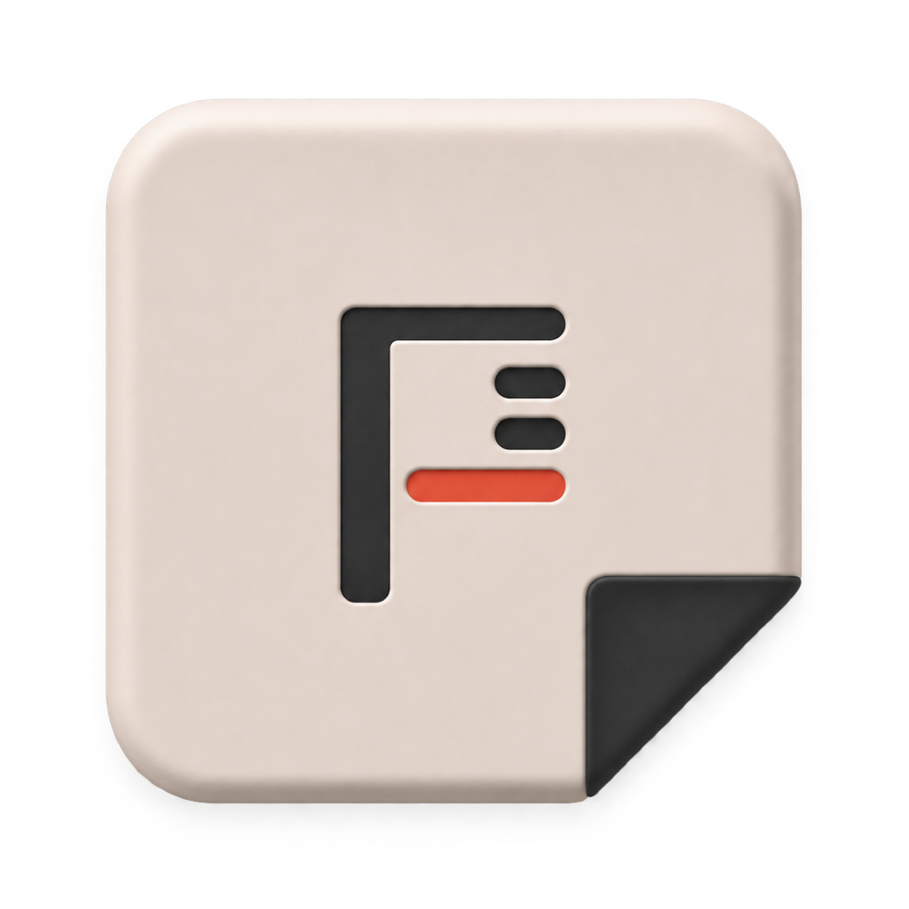
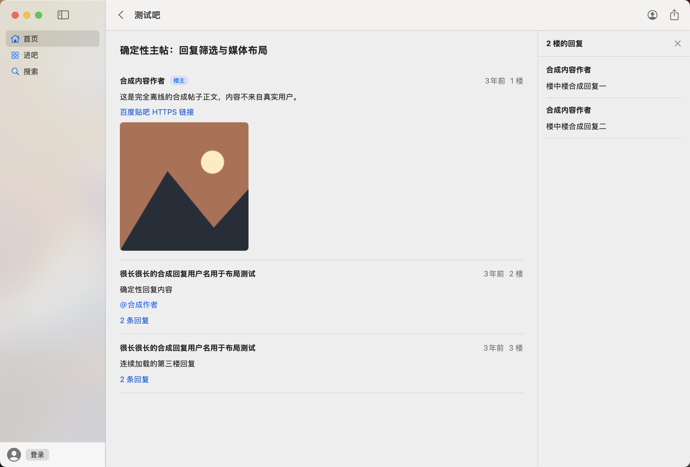
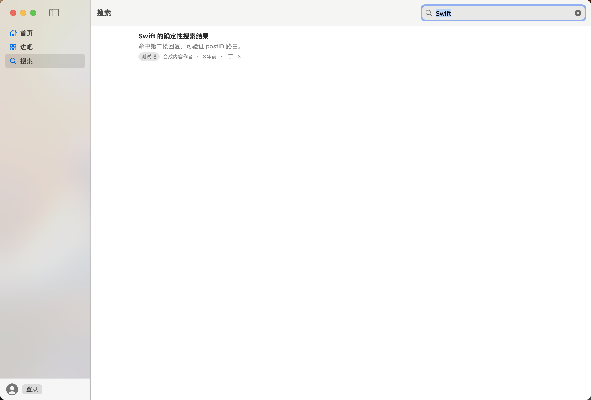
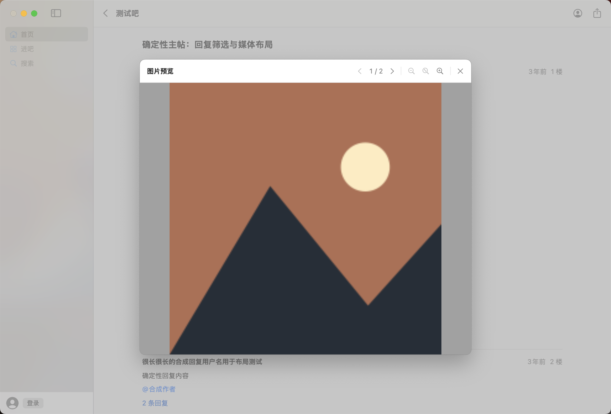
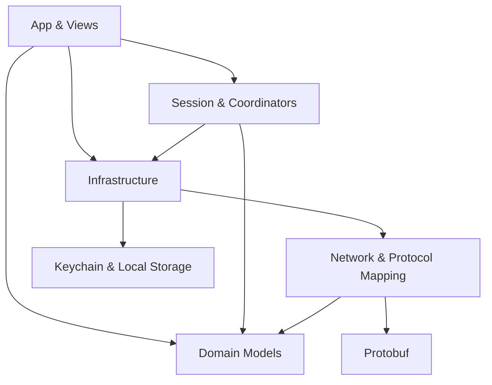

<div align="right">

**English** | [简体中文](README.zh-CN.md)

</div>

<div align="center">



# TiebaPure-Mac

**Native macOS client for Baidu Tieba**

SwiftUI · AppKit · WebKit Login · SwiftPM · Sparkle Auto-Update

[](#building)
[](Package.swift)
[](LICENSE)

<table>
  <tr>
    <td width="50%"></td>
    <td width="50%"></td>
  </tr>
  <tr>
    <td width="50%"></td>
    <td width="50%"></td>
  </tr>
</table>

<details>
  <summary><b>more</b></summary>
  <br />
  <table>
    <tr>
      <td width="50%"></td>
      <td width="50%"></td>
    </tr>
  </table>
</details>

</div>

## Overview

**TiebaPure-Mac** is a native macOS desktop client derived from [TiebaPure-iOS](https://github.com/infinityf4p/TiebaPure-iOS), engineered with SwiftUI and AppKit and optimized for large desktop displays and keyboard-first navigation.

It preserves full upstream Git history and original author attributions while removing mobile-specific touch transitions and simulator dependencies, focusing on responsive browsing, searching, reading, and account management on macOS.

## Features

- 🧭 **Desktop Navigation** — Switch among Home, Forums, Search, Followed Forums, and Bookmarks and pick up where you left off in each section.
- 📖 **Seamless Reading Experience** — Continuous floor scrolling, author-only reading, and a native Inspector for subpost discussions.
- 🔍 **Two-Tier Search** — Site-wide and in-forum keyword search. Recent forums and site-wide search history are saved locally.
- ⭐ **Account Library** — Follow or unfollow a forum and bookmark or remove a thread. The app reads back changes before updating the sidebar.
- 🔐 **Isolated Login & Secure Storage** — Official authentication inside isolated WebKit containers. Session credentials are encrypted directly in the macOS Keychain with proactive expiration detection.
- 🖼️ **Native Media Rendering** — Click an image in a post or subpost to preview and zoom it. Voice and video links open externally.
- ⌨️ **Keyboard-Driven Shortcuts** — Complete keyboard shortcuts for section switching, search focus, content refreshing, and history navigation.
- 🔄 **Automatic Updates** — Integrated Sparkle 2 framework for Ed25519 signature-verified updates directly from GitHub Releases.
- 🎨 **Adaptive macOS Appearance** — Fluid support for Light and Dark system appearances following Apple Human Interface Guidelines.

## Keyboard Shortcuts

| Shortcut | Action |
| --- | --- |
| `⌘1` / `⌘2` / `⌘3` | Switch to Home / Forums / Search |
| `⌘F` | Focus search bar (in-forum on forum pages, site-wide elsewhere) |
| `Return` | Submit forum name or search query |
| `Esc` | Close image preview, clear search input, or exit input focus |
| `←` / `→` | Move between images in the preview |
| `⌘R` | Refresh current page, forum, or thread |
| `⌘[` / `⌘]` | Navigate Back / Forward in history |
| `⌥⌘1` / `⌥⌘2` | Latest / Relevant for search results, or reply time / publication time for forum topics |
| `⌥⌘3` | Toggle featured topics in the forum |

## Installation

System requirements: macOS 14+ (Sonoma or later), Apple Silicon and Intel Universal support.

### Homebrew

```bash
brew tap yamakze/tiebapure-mac https://github.com/yamakze/TiebaPure-Mac.git
brew install --cask yamakze/tiebapure-mac/tiebapure-mac
```

Upgrade:

```bash
brew update
brew upgrade --cask yamakze/tiebapure-mac/tiebapure-mac
```

### Manual Download

Download the latest `TiebaPure-Mac-<version>.zip` from [Releases](https://github.com/yamakze/TiebaPure-Mac/releases/latest), unpack it, and drag `TiebaPure-Mac.app` into your **Applications** folder.

If macOS rejects the download, compare the ZIP with `SHA256SUMS.txt` from the same release and download it again if the hash differs.

## Building

Requires macOS 14+ and Xcode 15+. Managed via SwiftPM and orchestrated with the root `Makefile`:

```bash
# Build the local macOS app bundle (artifacts/macos/TiebaPure-Mac.app)
make build

# Build and launch the application directly
make run

# Run core regression test suites
make test

# Verify project boundaries, versioning, and compliance files
make verify

# Build Universal release package
make release

# Clean build caches and review artifacts
make clean
```

Standard tests rely on deterministic local fixtures and avoid live network access. To run read-only online connectivity verification prior to release:

```bash
RUN_ANONYMOUS_LIVE_SMOKE=1 swift test --filter AnonymousLiveSmokeTests
```

## Architecture

```
Sources/TiebaPureMac/
├── App/                # macOS scenes, account screens, reader, and media views
├── Application/        # Account session and write coordination
├── Domain/             # Business models and content filtering
├── Infrastructure/     # Tieba API, protocol mapping, Keychain, and local storage
└── DebugSupport/       # Offline development fixtures and screenshot runner support
```



## Documentation

| Document | Description |
| --- | --- |
| [Architecture Decisions](docs/architecture.md) | macOS architecture convergence, state ownership, and modular boundaries |
| [Privacy & Data Handling](docs/privacy.md) | Official endpoint direct connectivity, Keychain protection, and local boundaries |
| [Contributing & Release](CONTRIBUTING.md) | Development standards, Git commit guidelines, and GitHub Release workflow |
| [Third-Party Licenses](LICENSES/README.md) | Pinned dependency versions and license notices for Sparkle and SwiftProtobuf |
| [Notice & Attribution](NOTICE.md) | Original copyright attributions, baseline commits, and modification notices |

## Declarations & Acknowledgements

- This project is an independent third-party desktop client with no affiliation, authorization, or endorsement from Baidu Inc. or Baidu Tieba. Protocols rely on unofficial endpoints and are subject to server-side changes.
- Special thanks to [infinityf4p](https://github.com/infinityf4p/TiebaPure-iOS) and upstream contributors.
- Protocol research credits to the [TiebaLite](https://github.com/HuanCheng65/TiebaLite) and [aiotieba](https://github.com/lumina37/aiotieba) open-source communities.
- Distributed under the [GPL-3.0-only](LICENSE) license.
