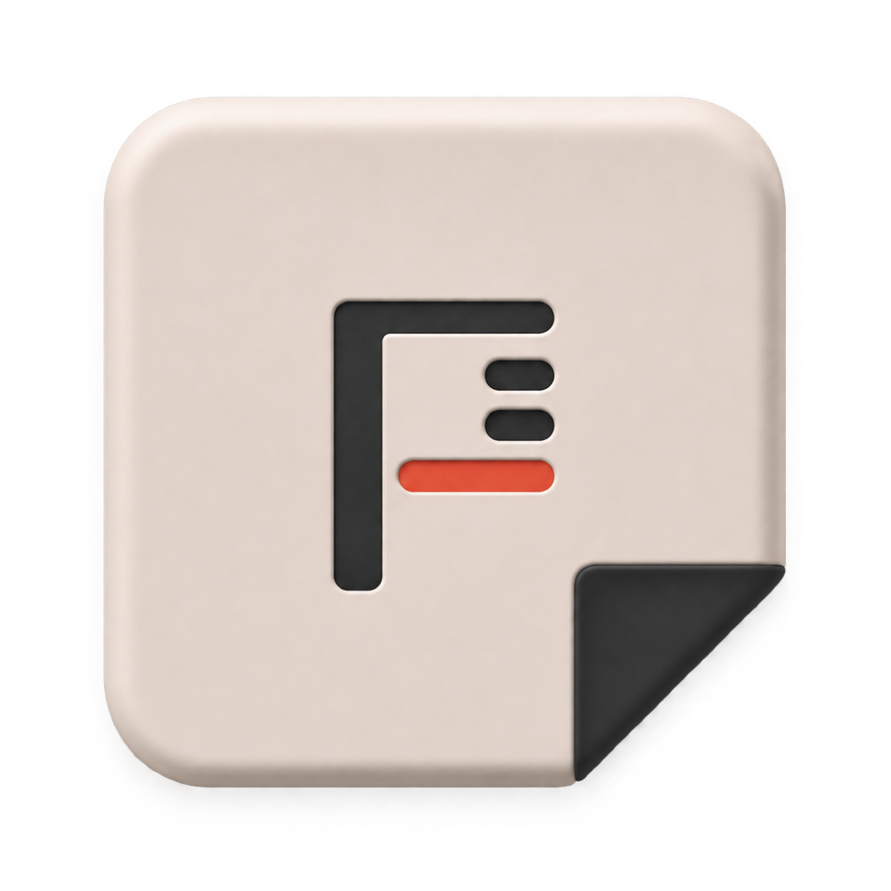
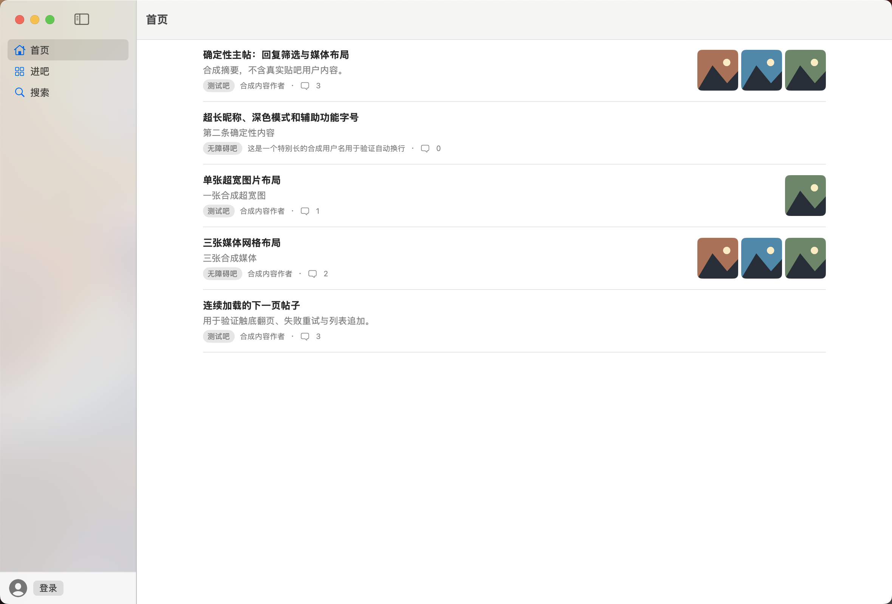
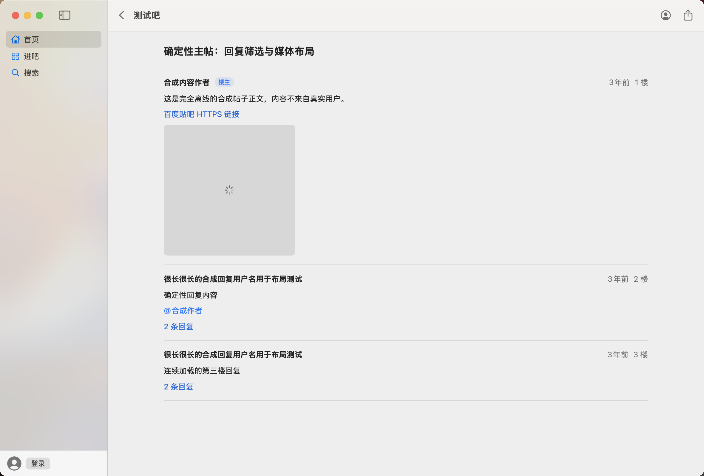
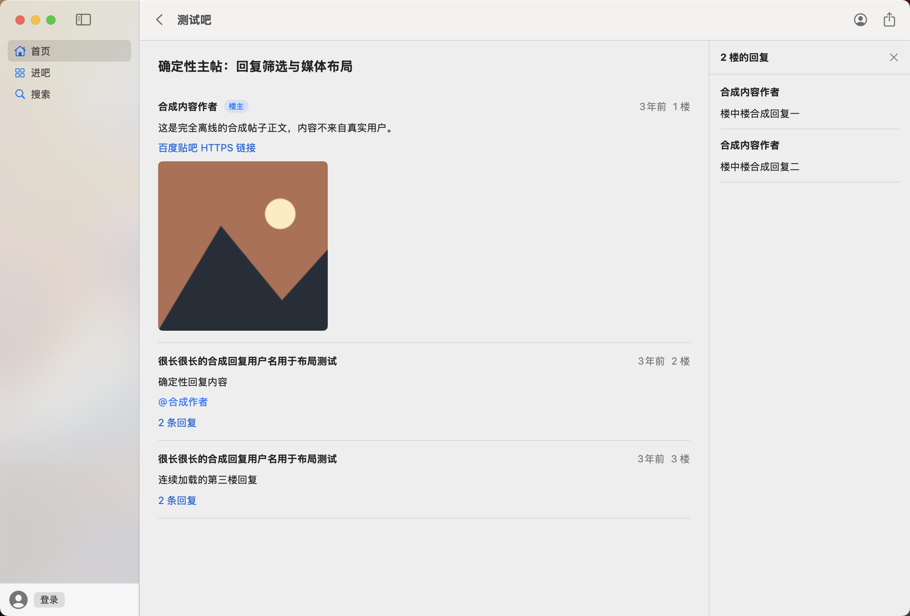
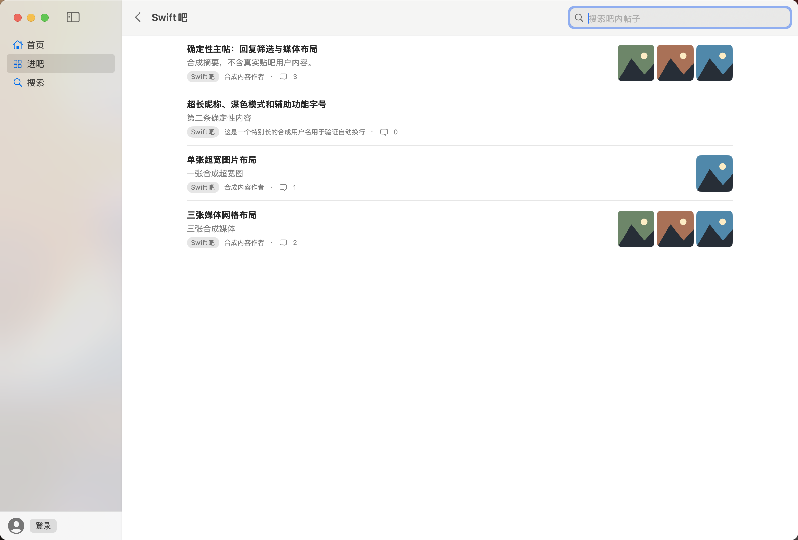
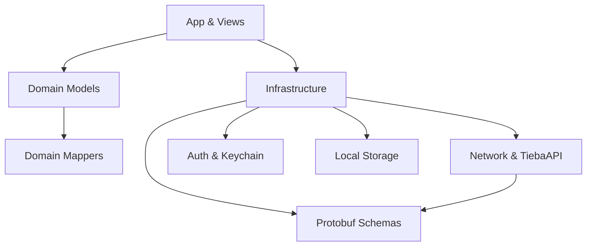

<div align="right">

[English](README.md) | **简体中文**

</div>

<div align="center">



# TiebaPure-Mac

**原生 macOS 百度贴吧桌面客户端**

SwiftUI · AppKit · WebKit · SwiftPM · Sparkle

[](#构建与运行)
[](Package.swift)
[](LICENSE)

<table>
  <tr>
    <td width="50%"></td>
    <td width="50%"></td>
  </tr>
  <tr>
    <td width="50%"></td>
    <td width="50%"></td>
  </tr>
</table>

</div>

## 产品简介

**TiebaPure-Mac** 是一款基于 [TiebaPure-iOS](https://github.com/infinityf4p/TiebaPure-iOS) 派生的原生 macOS 客户端，基于 SwiftUI 与 AppKit 构建，针对桌面大屏与键盘操作深度优化。

项目专注于桌面端贴吧浏览、检索、阅读与账号管理，移除全部移动端触摸转场与模拟器依赖。

## 功能特性

- 🧭 **桌面导航** — 侧栏整合首页推荐、进吧、搜索、关注与收藏，支持前进后退。
- 📖 **贴文阅读** — 楼层连续加载，可只看楼主，通过右侧 Inspector 查看楼中楼。
- 🔍 **搜索** — 支持全站与吧内关键词搜索，保存最近访问的贴吧与全站搜索历史。
- ⭐ **关注与收藏** — 可关注或取关贴吧、收藏或取消收藏帖子。应用回读状态后同步侧栏列表。
- 🔐 **隔离登录与安全存储** — 基于系统 WebKit 容器完成官方登录认证，会话凭据存储于系统 Keychain，支持会话过期检测与平滑登出。
- 🖼️ **原生图文呈现** — 显示贴吧表情与贴内图片，通过外部应用打开语音与视频链接。
- ⌨️ **系统级快捷键** — 完整支持键盘流操作，涵盖栏目切换、搜索框聚焦、列表刷新与历史导航。
- 🔄 **自动更新** — 集成 Sparkle 2 框架，通过 Ed25519 签名验证从 GitHub Releases 自动检测与安装更新。
- 🎨 **原生桌面外观** — 深度适配 macOS 浅色与深色模式，严格遵循 Apple 人机交互界面规范。

## 键盘快捷键

| 快捷键 | 对应操作 |
| --- | --- |
| `⌘1` / `⌘2` / `⌘3` | 快速切换至 首页 / 进吧 / 搜索 |
| `⌘F` | 聚焦当前搜索框；在吧页搜索当前贴吧，其他页面激活全站搜索 |
| `Return` | 提交贴吧名称或搜索词 |
| `Esc` | 清空搜索内容或退出输入焦点 |
| `⌘R` | 刷新当前页面列表或帖子内容 |
| `⌘[` / `⌘]` | 返回上一级 / 前进至刚浏览的页面 |
| `⌥⌘1` / `⌥⌘2` | 搜索结果按最新／相关排序，吧内主题按回复时间／发帖时间排序 |
| `⌥⌘3` | 在吧内主题列表切换「只看精华」 |

## 安装与使用

系统要求：macOS 14+，支持 Apple Silicon 与 Intel 架构。

### 通过 Homebrew 安装

```bash
brew tap yamakze/tiebapure-mac https://github.com/yamakze/TiebaPure-Mac.git
brew install --cask yamakze/tiebapure-mac/tiebapure-mac
```

更新应用：

```bash
brew update
brew upgrade --cask yamakze/tiebapure-mac/tiebapure-mac
```

### 手动下载

从 [Releases](https://github.com/yamakze/TiebaPure-Mac/releases/latest) 下载最新发布的 `TiebaPure-Mac-<version>.zip`，解压后将 `TiebaPure-Mac.app` 拖入 **应用程序** 目录。

若 macOS 拒绝打开应用，用同一版本发布页的 `SHA256SUMS.txt` 核对 ZIP。校验不符时重新下载。

## 构建与运行

开发环境基线为 macOS 14+ 与 Xcode 15+。项目采用纯 SwiftPM 管理，通过根目录 `Makefile` 统一调度：

```bash
# 构建本地应用包（artifacts/macos/TiebaPure-Mac.app）
make build

# 构建并直接启动应用
make run

# 运行核心回归测试套件
make test

# 校验项目边界、版本号与合规文件
make verify

# 构建通用架构 Release 发布包
make release

# 清理构建缓存与临时审查输出
make clean
```

日常测试使用确定性本地数据桩，不访问真实贴吧接口。发布前需运行匿名网络连通性冒烟验证时执行：

```bash
RUN_ANONYMOUS_LIVE_SMOKE=1 swift test --filter AnonymousLiveSmokeTests
```

## 项目架构

```
Sources/TiebaPureMac/
├── App/                # 场景配置、主窗口、阅读器布局、设置视图与更新协调
├── Domain/             # 贴吧核心业务模型、内容过滤规则与协议映射
├── Infrastructure/     # 网络通信客户端、Protobuf 序列化、Keychain 认证、本地存储与状态协调器
└── DebugSupport/       # 离线开发数据桩与截图用例支持
```



## 文档索引

| 文档 | 说明 |
| --- | --- |
| [架构设计决策](docs/architecture.md) | macOS 架构收敛、状态归属与模块边界决策记录 |
| [数据处理与隐私声明](docs/privacy.md) | 官方接口直连、Keychain 凭据保护与本地数据范围说明 |
| [贡献与发布约定](CONTRIBUTING.md) | 代码开发规范、Git 提交格式与 GitHub Release 发布指引 |
| [第三方依赖许可](LICENSES/README.md) | Sparkle 与 SwiftProtobuf 依赖版本与许可证总览 |
| [来源与修改声明](NOTICE.md) | 原始项目版权归属、基线提交与修改范围声明 |

## 声明与致谢

- 本项目为开源第三方桌面客户端，与百度公司或百度贴吧无隶属、授权或认可关系。贴吧协议来自非官方接口，服务端行为可能随官方调整而变更。
- 感谢 [infinityf4p](https://github.com/infinityf4p/TiebaPure-iOS) 及上游所有贡献者。
- 协议逆向与解析致谢 [TiebaLite](https://github.com/HuanCheng65/TiebaLite) 与 [aiotieba](https://github.com/lumina37/aiotieba) 开源社区的研究成果。
- 本项目依据 [GPL-3.0-only](LICENSE) 开源发布。
